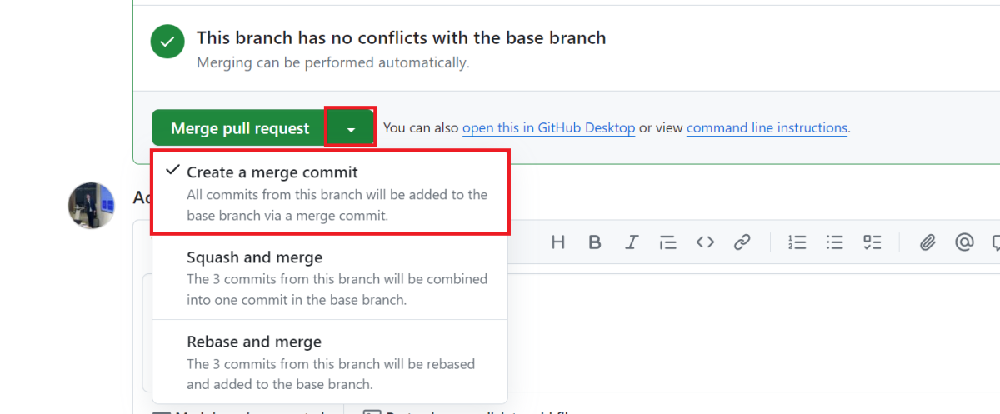
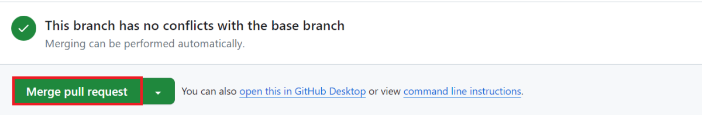
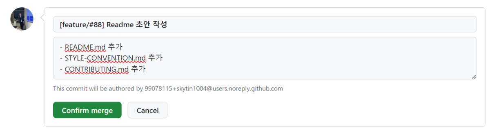

# Merge 가이드

PR을 Merge할 때 GitHub에서 밟는 절차를 설명합니다.

커밋·Merge 메시지 형식은 [커밋 메시지 규칙](../.claude/rules/commits.md)에서 관리합니다.

---

## Merge 전략

모든 PR은 작업 브랜치 → `upstream/main` 한 경로뿐입니다. **Merge Commit**을 사용해 개별 커밋 히스토리를 보존합니다.

---

## WIP 커밋 정리 방법

`git rebase -i`로 WIP 커밋을 squash합니다.

```bash
# main 기준으로 만든 브랜치에서, main 이후 커밋을 정리
git rebase -i upstream/main
```

에디터가 열리면 WIP 커밋을 정리합니다.

```
pick a1b2c3d feat: 게시판 목록 컴포넌트 추가
squash d4e5f6g WIP: 임시 저장               ← squash로 변경 (윗 커밋에 합치기)
squash g7h8i9j fix: 오타 수정               ← squash로 변경
pick j0k1l2m feat: 게시판 검색 기능 추가
```

> - `pick`: 커밋 유지
> - `squash` (또는 `s`): 바로 위 커밋에 합치기
> - `fixup` (또는 `f`): 합치되 커밋 메시지는 버리기 (WIP 메시지 제거 시 편리)

정리 후 force push:

```bash
git push origin feat/board-search --force-with-lease
```

> `--force-with-lease`: 다른 사람이 이미 push한 내용이 있으면 덮어쓰지 않아 안전합니다.

---

## Squash merge를 써도 되는 경우

WIP 커밋이 남아있는데 rebase 정리가 번거롭다면, **GitHub에서 Squash merge**를 사용하는 것도 괜찮습니다.

단, 아래 조건을 모두 만족할 때만 사용합니다.

| 조건                                    | 이유                                                                  |
| --------------------------------------- | --------------------------------------------------------------------- |
| 브랜치의 커밋이 하나의 기능 단위일 것   | 여러 기능이 섞인 브랜치를 Squash하면 히스토리 추적이 어려워짐         |
| Squash 커밋 메시지를 명확하게 작성할 것 | 개별 커밋 메시지가 사라지므로 하나의 메시지가 변경 전체를 설명해야 함 |

Squash 커밋 메시지도 [커밋 메시지 규칙](../.claude/rules/commits.md)의 형식을 따릅니다.

---

## Merge 절차 (Merge Commit 기준)

### 1. Merge 방식 선택

PR 하단에서 **Create a merge commit** 을 선택합니다.



### 2. Merge pull request 선택



### 3. 커밋 제목 · 본문 수정 후 Confirm merge



커밋 제목·본문은 [커밋 메시지 규칙](../.claude/rules/commits.md#merge-커밋)을 따릅니다.

---

## 요약

```
작업 중 WIP 커밋 발생
        ↓
PR 올리기 전 git rebase -i 로 정리  ← 권장
        ↓
작업 브랜치 → main  :  Merge Commit
```

- Merge 권한이 있는 Maintainer만 Merge를 진행합니다.
